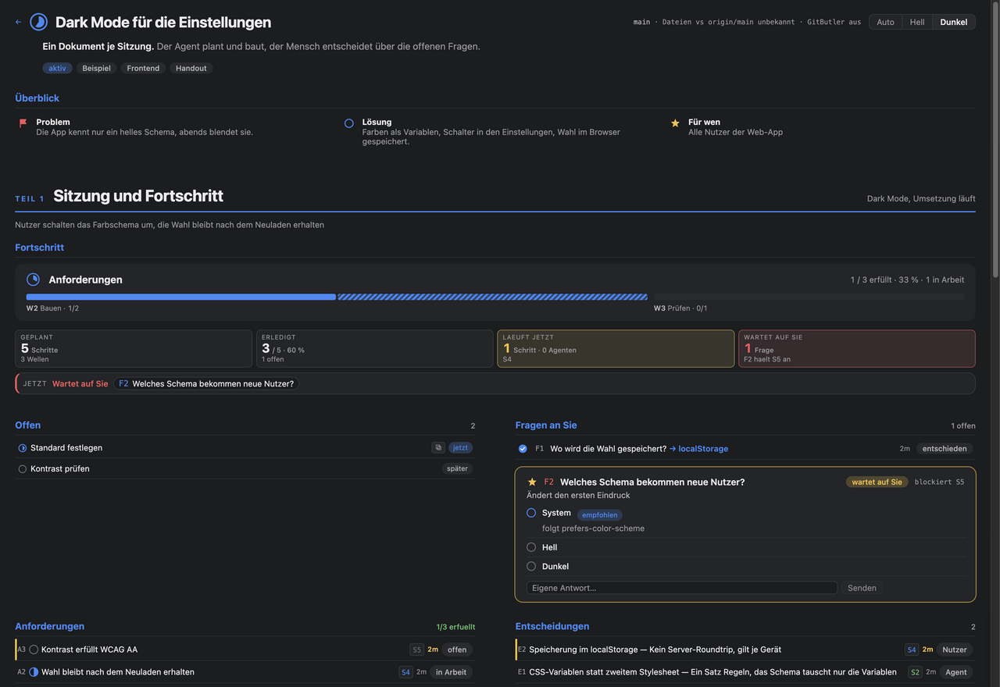
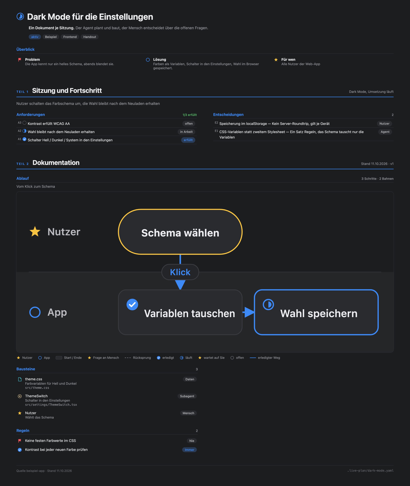
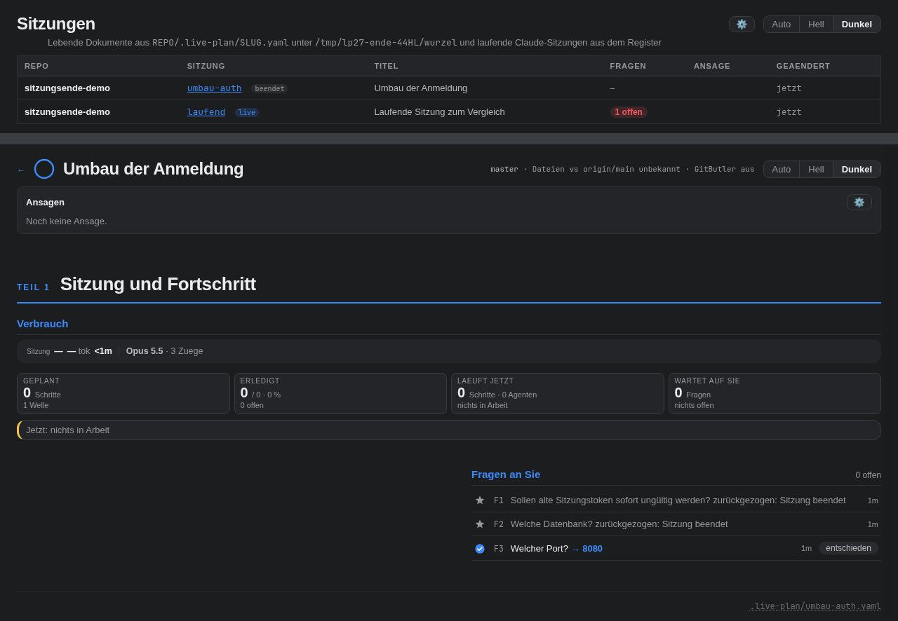
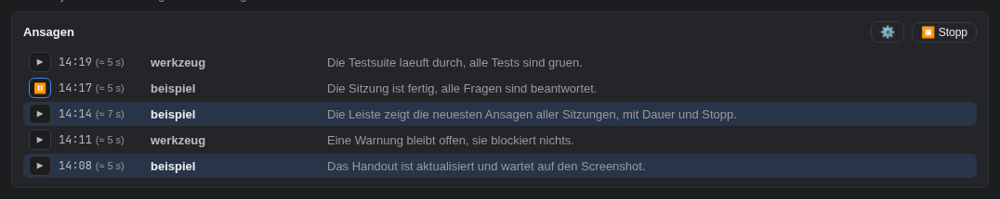
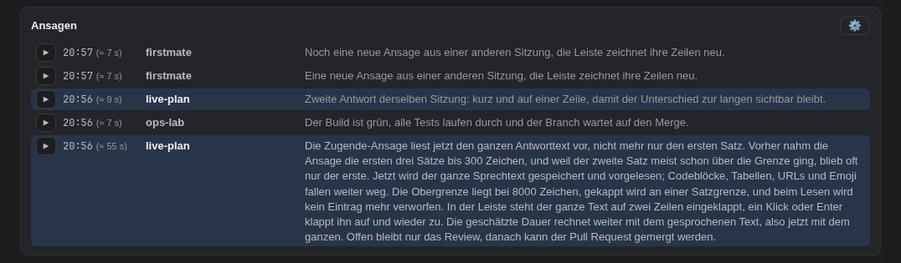
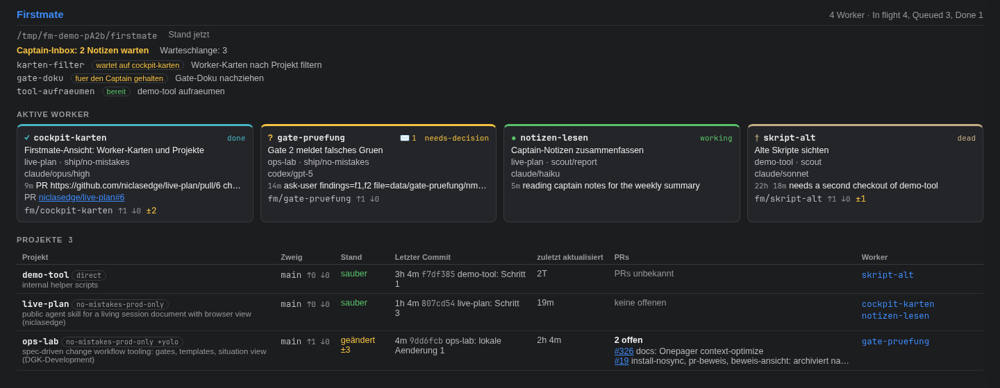
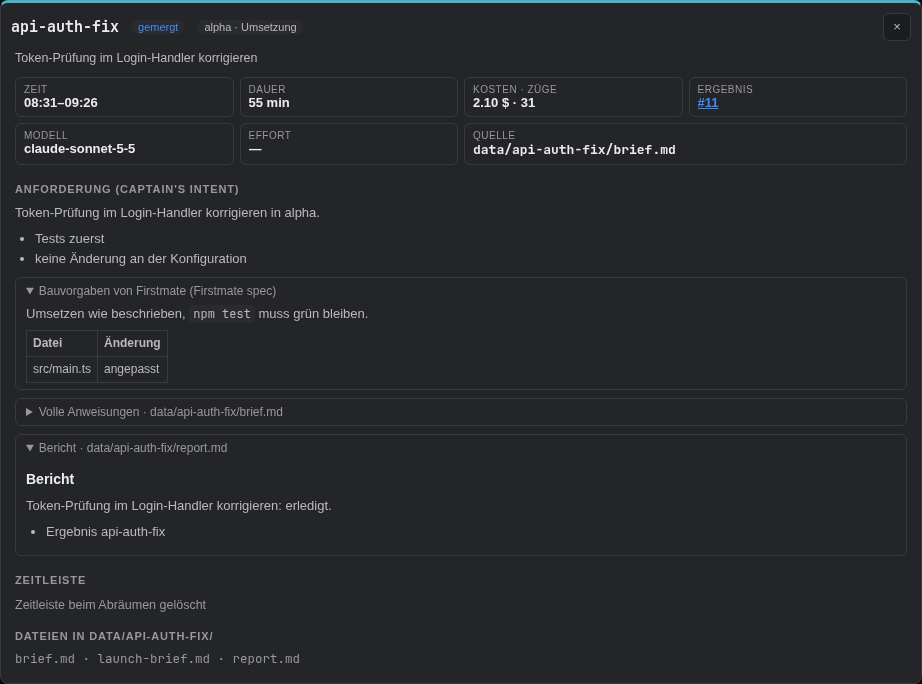
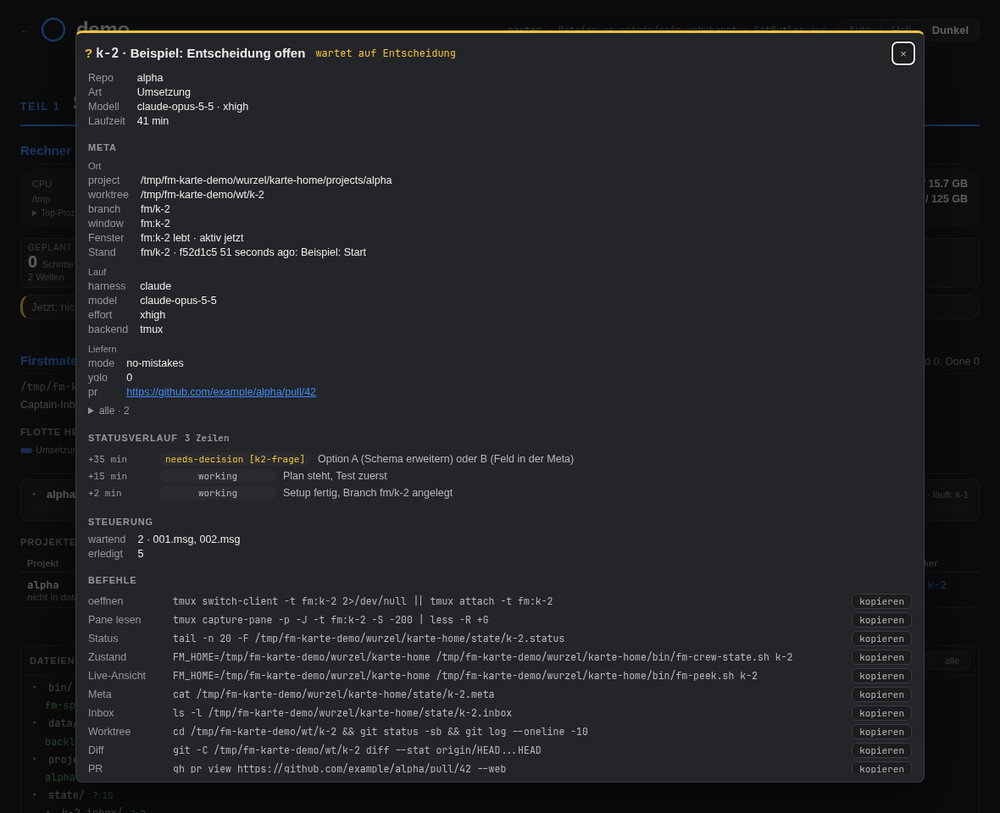

# live-plan

Agent-Skill für Claude Code und andere Coding-Agenten: Eine Sitzung führt ein lebendes Dokument
(`REPO/.live-plan/SLUG.yaml`) mit eigener Browser-Ansicht. Die Ansicht zeigt Fragen mit Optionen,
Schritte in Bahnen und Wellen sowie Belege. Ein Klick auf eine Option schreibt die Entscheidung
zurück in die Datei.

## Beispiel

Die Plan-Ansicht im Browser (`live-plan open SLUG`): Fortschritt, offene Fragen mit Optionen,
Anforderungen und Entscheidungen.



Das Handout derselben Sitzung (`live-plan handout SLUG`): Kopf, Anforderungen, Entscheidungen und
Dokumentation als PNG und eigenständiges HTML unter `.live-plan/handouts/`.



## Installation

Mit dem [skills-Installer](https://skills.sh):

```bash
pnpm dlx skills add niclasedge/live-plan        # ins aktuelle Projekt (.claude/skills/live-plan)
pnpm dlx skills add niclasedge/live-plan -g     # global für alle Projekte
```

`npx skills add niclasedge/live-plan` funktioniert ebenso.

Von Hand:

```bash
git clone https://github.com/niclasedge/live-plan ~/.claude/skills/live-plan
```

### Mod `live-plan-sitzung` (Claude Code)

Der Mod verbindet jede Claude-Code-Sitzung mit dem live-plan. Er legt beim Sitzungsstart per
`live-plan neu --auto` die Sitzung an und führt ein Register nach
`~/.cache/live-plan/sitzungen/<id>.json` (Kontext, Kosten, Subagenten, Fortschritt), das die
Ansicht als Live-Block zeigt. Dazu kommen die Werkzeuge `progress` und `step`, Antworten auf
`AskUserQuestion` direkt im Browser, der Stand im System-Prompt, die Ansagen (siehe unten) und der
Sprengradius, der riskante Bash-Befehle bis zur Freigabe anhält. Schließt die Sitzung eine Frage
ohne Entscheidung (Esc im Dialog, Abbruch, keine Antwort, Sitzungsende), zieht der Mod sie im
live-plan zurück (`zurueckgezogen: GRUND` in der Frage); sie wartet dann nirgends mehr und steht
ausgegraut mit ihrem Grund in der Ansicht. Am Sitzungsende gilt das für jede offene Frage, auch ohne
laufenden Server (dann schreibt `live-plan frage-zurueck --alle` die YAML); Liste und Seite zählen gleich:



In einer Terminal-Sitzung:

```
/plugin install live-plan-sitzung --marketplace niclasedge/live-plan
```

Mit `y` den Marketplace hinzufügen, dann den Scope wählen. Der Mod sucht das Skript unter
`~/.claude/skills/live-plan/live-plan` (bzw. unter `$CLAUDE_CONFIG_DIR`); ein anderer Pfad geht
über die Option `skript` oder `LIVE_PLAN_SKRIPT`. Quelltext und Tests liegen unter [`mod/`](mod/)
(`claude plugin test mod`).

## Voraussetzungen

- [bun](https://bun.sh) für Server und Startskript
- optional Chrome oder Chromium für `live-plan handout`

## Benutzung

Die Anleitung für den Agenten steht in [`SKILL.md`](SKILL.md). Kurz:

```bash
LP=~/.claude/skills/live-plan/live-plan
$LP neu SLUG      # Sitzung aus vorlage.yaml anlegen
$LP open SLUG     # Server starten, Ansicht im Browser öffnen
$LP frage-zurueck F2 [GRUND] [--sitzung SLUG]   # Frage ohne Entscheidung schließen
$LP stop          # Server beenden
```

Der Server lauscht auf Port 4410 (`LIVE_PLAN_PORT`) und hat keine Anmeldung. Er ist im LAN
erreichbar; legen Sie keine Secrets in die Sitzungsdatei.

Der Diff im Abschnitt Dateien zeigt auch eine git-ignorierte Datei, aber nur, wenn die Sitzung sie
laut Register gelesen oder geschrieben hat, sie in der Wurzel liegt und der Aufruf vom eigenen Rechner
kommt (Quell-IP der Verbindung 127.0.0.0/8 oder ::1, kein Header). Jedem anderen Aufruf, etwa aus dem LAN,
meldet er für eine git-ignorierte Datei eine Ablehnung (403) statt des Inhalts. Typische Secret-Namen
(`.env`, `.env.*`, `*.pem`, `*.key`, `id_rsa*`, `id_ed25519*`, `*credentials*`, `*secret*`) zeigt er
dabei nie, sondern meldet eine Ablehnung. Die eigene Plan-Datei der Sitzung (`.live-plan/<id>.yaml`, im
Seitenfuß anklickbar) gehört ihr und öffnet auch ohne Registereintrag, jede andere Plan-Datei nicht.

Bilder (png, jpg, jpeg, gif, webp, svg) zeigt das Diff-Modal als Bild: `GET /api/REPO/<id>/bild?p=PFAD`
liefert die Rohbytes mit dem Inhaltstyp der Endung, unter denselben Pfadregeln wie der Diff (im Baum oder im
Register, kein `..`, kein Symlink, git-ignoriert nur für den eigenen Rechner, keine Secret-Namen). Über
10 MiB antwortet er 413, jede andere Endung 415. Die Antwort trägt `nosniff` und `Content-Security-Policy:
sandbox`; ein SVG läuft nur in einem `` und führt dort kein Skript aus. Geändert zeigt es nur die neue Version.
Tests: `node --test server.test.ts` (startet `bun server.ts`).

## Ansagen

Die Übersicht (`http://localhost:4410/`) liest am Ende eines Agenten-Zugs dessen Antwort vor,
über alle Sitzungen hinweg, mit der Sprachausgabe des Browsers (Web Speech API, `speechSynthesis`), vorneweg
das Repo: „live-plan: Der Umbau ist fertig …“.

- **Automatisch:** Die Mod gibt am Ende jedes beantworteten Zugs der Hauptsitzung (nicht der Subagenten) die
  letzte Antwort an `live-plan sage --auto`. Das Skript entfernt Codeblöcke, Tabellen, Überschriften, Bilder,
  URLs, HTML, Emoji und Markdown-Zeichen (ein Link wird zu seinem Text) und nimmt den ganzen übrigen Text, höchstens
  8000 Zeichen (bei 14 Zeichen je Sekunde gut neun Minuten); ein längerer endet am letzten ganzen Satz davor, und
  besteht er fast nur aus einem riesigen Satz, an einer Wortgrenze mit „…“. Eine
  Antwort unter vier Wörtern („Captain, shipshape.“) wird nicht angesagt.
- **Selbst formuliert:** `live-plan sage "<2-3 Sätze>"` sagt einen eigenen Text an (gesäubert, bis sechs Sätze und
  600 Zeichen; Sitzung aus `CLAUDE_SESSION_ID`, Repo aus der Git-Wurzel). Er ersetzt die automatische Ansage
  desselben Zugs: `--auto` übergeht eine Sitzung, die seit dem Beginn des Zugs selbst angesagt hat.

Die Ansagen stehen als eine JSON-Zeile je Ansage (`zeit`, `id`, `repo`, `text`, `quelle` `auto` oder `sage`) in
`LIVE_PLAN_CACHE/ansagen.jsonl`. Angehängt wird mit `O_APPEND`; bei mehr als 250 Zeilen oder mehr als 1,25 MiB
(1 MiB plus 256 KiB Abstand) schreibt der nächste Schreiber die letzten 200 neu, höchstens aber 768 KiB davon: bei
langen Ansagen fallen vorne weitere weg. Der Abstand verhindert, dass ab 1 MiB jeder Anhang die ganze Datei neu
schreibt. Anhängen und Kürzen laufen unter der Sperre `ansagen.jsonl.sperre` (O_EXCL, eine Sperre älter als 10 s gilt
als verwaist), denn ein Anhang neben einem Kürzen ginge mit dem Ersetzen der Datei verloren. Ein Schreiber wartet bis
zu 12 s auf die Sperre, nimmt also eine verwaiste sicher noch; bekommt er sie nicht, hängt er nichts an, und
`live-plan sage` meldet `Ansage nicht gespeichert: …` mit Exit-Code 1. Scheitert so die automatische Ansage am
Ende eines Zugs, zeigt die Mod diese Meldung als Toast in der Sitzung (ohne Meldung den Exit-Code). Eine kaputte Zeile oder eine fehlende Datei
kostet nur diese Ansagen; ein Text über 8000 Zeichen wird auch beim Lesen gekappt wie beim Schreiben, nicht verworfen.
Der Server liest
die Datei nur: `GET /api/ansagen` liefert die letzten 200, neueste zuerst,
`GET /api/ereignisse` meldet als Ereignisstrom jede Änderung an Ansagen und Einstellungen. Ansagen schreiben gibt es
über HTTP nicht.

In der Tabelle der Übersicht zeigt die Spalte **ansage** je Sitzung ▶ und die Uhrzeit ihrer neuesten Ansage (der
Text steht im Tooltip); ▶ liest sie vor. Sitzungen ohne Ansage bleiben dort leer. Das Menü **⚙** im Kopf enthält
den Schalter **🔊 Vorlesen** (jede neue Ansage aus allen Sitzungen automatisch vorlesen, an oder aus), die Wahl der
Stimme (deutsche zuerst, Vorgabe Deutsch) und **▶ Letzte Ansage nochmal**. Beides steht zentral in
`LIVE_PLAN_CACHE/einstellungen.yaml` (`vorlesen: true|false`, `stimme: "<Name>"` oder `null`) und gilt damit für
jeden Browser: `GET /api/einstellungen` liest sie, `POST /api/einstellungen` (JSON `{ vorlesen?, stimme? }`, bis
2 KB) schreibt sie, unter denselben Regeln wie eine Entscheidung (nur von der eigenen Seite, kein fremder `Origin`).
Eine kaputte oder fehlende YAML gilt als Vorgabe (aus, deutsche Stimme). Die Stimme steht als Name; hat ein Browser
sie nicht, spricht er mit seiner ersten deutschen Stimme. Browser sprechen erst nach einem Klick auf die Seite; bis
dahin steht bei Vorlesen an ein Hinweis neben ⚙ und neue Ansagen werden nur gelistet. Weil die Seite ohne Anmeldung
im LAN erreichbar ist, liest dort jeder die Ansagen mit und kann Vorlesen und Stimme umstellen.
Auf jeder Sitzungsseite gilt dasselbe: Vorlesen und Stimme wirken dort genauso, und neue Ansagen aller Sitzungen werden
vorgelesen. Oben unter dem Kopf steht die Leiste **Ansagen** mit den letzten fünf Ansagen aus allen Sitzungen, neueste
zuerst. ▶ liest eine davon sofort vor; die Zeilen der geöffneten Sitzung sind hervorgehoben. Der Text einer Zeile steht
ganz darin, eingeklappt auf zwei Zeilen; ein Klick oder Enter klappt ihn auf und wieder zu, und ein Neuzeichnen der
Leiste behält das. Das Menü ⚙ in der Leiste
ist das der Übersicht. Eine neue Ansage zeichnet nur die Leiste neu, nicht den Plan. Das Handout (`?handout=1`) bleibt
ohne Leiste und ohne Ansagen.
Mehrere Tabs teilen sich die Verbindung: ein Tab hält `GET /api/ereignisse`, die anderen bekommen Änderungen über einen
BroadcastChannel. Vorgelesen wird nur im Sprecher-Tab, also dem, den der Nutzer zuletzt bedient hat (ohne Sprecher im
Leiter-Tab), und jede Ansage genau einmal. Ohne Web Locks (etwa über eine LAN-IP, Tailscale, `.local` oder ohne sicheren
Kontext) lauscht jeder Tab selbst; gesprochen wird dann nur im zuletzt geklickten Tab, und schließt der, schweigt es bis
zum nächsten Klick oder Tabwechsel. Dort hält jeder Sitzungstab zwei Dauerverbindungen; ab etwa drei Sitzungstabs stockt
der Browser (HTTP/1.1, 6 Verbindungen je Host). Über `localhost` (`live-plan open`) zeigte sich das in unseren Läufen
nicht. Siehe #20.

Die Steuerung der Ansagen (Übersicht und Leiste der Sitzungsseite): hinter der Uhrzeit steht die geschätzte Dauer in
Klammern, etwa `(≈ 5 s)`. Sie ergibt sich aus der Länge des gesprochenen Textes (Repo und ganzer Text, nicht die
eingeklappte Anzeige) geteilt durch die Zeichen je Sekunde
dieses Browsers; die Vorgabe sind 14. Jede regulär zu Ende gesprochene Ansage mischt ihr gemessenes Tempo gleitend hinein
(0,7 alt, 0,3 neu; Messwerte außerhalb von 4 bis 40 zählen nicht). Der Wert liegt im `localStorage` dieses Browsers
(`live-plan.zeichen-je-sekunde`), nicht in einer Datei. ▶ spielt eine Zeile sofort ab; läuft sie, zeigt sie ⏸, und ein
Klick hält an; pausiert zeigt sie ▶, und ein Klick setzt fort. ⏹ Stopp erscheint neben ⚙, solange etwas spricht,
pausiert ist oder in der Warteschlange wartet; er bricht die Ansage ab und leert die Warteschlange. Die Steuerung gilt
nur im Tab, der gerade spricht: nur dort stehen ⏸ und ⏹, die anderen Tabs zeigen nur ▶; ein Klick dort startet in jenem
Tab eine eigene Ausgabe. In der Leiste führt der Repo-Name zur Sitzung; die eigene ist mit `aria-current` markiert.
Eine lange Ansage spricht der Browser in Teilen von etwa 10 s beim gemessenen Tempo, mindestens 80 und höchstens
250 Zeichen (bei der Vorgabe 14 Zeichen je Sekunde 140; ganze Sätze, ein längerer Satz endet am Komma oder an einer
Wortgrenze), denn Chrome bricht mit Netzstimmen eine einzelne Äußerung nach etwa 15 s ab. Alle
Teile stehen gleich in der Warteschlange; ⏸, ▶ und ⏹ gelten für die ganze Ansage, und als beendet gilt sie erst mit
dem letzten Teil. Abgebrochene Ansagen (⏹ oder ▶ einer anderen Zeile) gehen nicht in das gemessene Tempo ein.





Tests: `node --test ansagen.test.ts liste.test.ts server.test.ts` (brauchen bun), Mod: `claude plugin test mod`.

## Firstmate-Cockpit

`cockpit.ts` zeigt die Worker eines [Firstmate](https://github.com/kunchenguid/firstmate)-Home.
Ohne Optionen startet eine Live-Ansicht, die sich alle 5 Sekunden neu aufbaut: je Worker ein
kleiner Kasten mit Rahmen, im Raster nach Breite des Terminals angeordnet (bei Größenänderung neu).
Der Rand trägt die id und den Zustand (working, paused, blocked, needs-decision, done, failed, dead
für ein fehlendes tmux-Fenster) samt Farbe; darin stehen Projekt · Art/Modus, Harness/Modell, die
letzte Statuszeile mit Alter, der PR, Zweig mit ahead/behind und Zahl geänderter Dateien und der
Befehl zum Öffnen des tmux-Fensters. Liegen ungelesene Nachrichten von Firstmate an den Worker
(`state/<id>.inbox/*.msg`), steht `✉ N` vor dem Zustand, wenn der Rand Platz hat. Zu Langes wird
gekürzt. Kopfzeile: Home, Zahl der Worker, Abschnitte des Backlogs, `tmux nicht erreichbar`, wenn
der tmux-Server nicht antwortet. Darunter die Captain-Inbox (wartende Notizen in `state/inbox/`, wie `fm-inbox.sh status`
sie zählt) und die Warteschlange (`## Queued`, in älteren Backlogs auch `## Held`, in
`data/backlog.md`): die ersten drei Aufträge mit dem, worauf sie warten (`wartet auf <id>`, solange
der Eintrag offen ist, `bis <Datum>`, `fuer den Captain gehalten`, `gehalten` oder `bereit`), der
Rest als `+N weitere`. Ende mit `q` oder Strg-C. Farbe nur im Terminal und ohne `NO_COLOR`.

```
Firstmate-Cockpit  /work/firstmate  1 Worker  In flight 1, Queued 5, Done 7  21:36:24Z
Captain-Inbox: 2 Notizen warten · Warteschlange: 5
  cockpit-folge-a1  [wartet auf live-plan-cockpit-inbox]  Cockpit: Notizen im --once lesbar
  airlock-dns-b2  [bis 2026-11-01]  airlock: DNS-Override pruefen
  fm-hold-c3  [fuer den Captain gehalten]  Firstmate: Wake-Queue entschlacken
  +2 weitere (--once)

┌─ ● live-plan-cockpit-inbox ──────────────────── ✉ 2 working ─┐
│ live-plan · ship/no-mistakes                                 │
│ claude/default/medium                                        │
│ 3m setup done on fm/live-plan-cockpit-inbox; backlog wait-r… │
│ fm/live-plan-cockpit-inbox ↑0 ↓0 ±2                          │
│ $ tmux attach -t firstmate:fm-live-plan-cockpit-inbox        │
└──────────────────────────────────────────────────────────────┘
```

`--once` gibt einmal alle Details aus: die wartenden Notizen mit Namen, die ganze Warteschlange und
je Worker Projekt, Art, Modus, Harness, Modell, tmux-Fenster und ob es lebt, letzte Statuszeile mit
Alter, offene Entscheidungen und Blocker, Inbox, PR, Stand des Worktrees (Zweig, ahead/behind,
geänderte Dateien, letzter Commit), Brief, die letzten Zeilen des Panes und darunter fertige Befehle
zum Öffnen des Fensters und zum Prüfen von Hand. Das gilt auch, wenn die Ausgabe in eine Pipe oder
Datei geht. `--json` enthält dasselbe (`notizen`, `warteschlange`, je Worker `inbox`). Das
Skript liest nur; es braucht node >= 22.18 (eingebautes Type-Stripping) oder bun.

```bash
./cockpit.ts                       # Live-Ansicht, Home aus FM_HOME, sonst FIRSTMATE_HOME, sonst /work/firstmate
./cockpit.ts --home ~/firstmate --watch 10
./cockpit.ts --once                # alle Details und Befehle je Worker
./cockpit.ts --json
```

Tests: `node --test cockpit.test.ts firstmate.test.ts flotte.test.ts`.

### Firstmate in der Ansicht

Liegt die Wurzel einer Sitzung in einem Firstmate-Home, zeigt ihre Seite im Browser
(`http://localhost:4410/firstmate/<sitzung>`) zusätzlich zu Verbrauch, Fortschritt und Dateien den
Abschnitt Firstmate. Ein Home erkennt die Ansicht am Aufbau (`bin/fm-spawn.sh`, `state/`, `data/`),
nicht am Namen; `FM_HOME` und `FIRSTMATE_HOME` aus der Umgebung des Servers gelten hier nicht, nur
im Cockpit.

- **Kopf:** Home, Zahl der Worker, Abschnitte des Backlogs, Captain-Inbox und die Warteschlange mit
  dem, worauf jeder Auftrag wartet.
- **Flotte heute:** die Aufgaben des Tages (laufende aus `state/<id>.meta` und `.status`, abgeschlossene
  aus den Done-Einträgen von `data/backlog.md` und `data/done-archive.md` samt `data/<id>/`) in drei Stufen:
  1. *Eingeklappt:* eine Linie je Repo (Tag `(repo: X)` im Backlog, sonst `project=` der Meta) auf einer
     gemeinsamen Zeitachse mit Marke für „jetzt“. Der Hover nennt jede Aufgabe unter dem Zeiger mit
     Zeit von–bis; ein Klick auf einen einzelnen Balken öffnet die Details, bei mehreren klappt er das
     Repo auf und markiert sie.
  2. *Aufgeklappt* (Klick auf den Kopf): eine Zeile je Aufgabe mit Balken, Zeit, Dauer, PR, Kosten.
     Für laufende Aufgaben zeigt ein gestrichelter Abschnitt die Schätzung: Start plus Median der
     abgeschlossenen Umsetzungen des Repos, mindestens 5 Minuten ab jetzt; ohne abgeschlossene
     Umsetzung gibt es keine Schätzung.
  3. *Details* (Klick auf eine Aufgabe): Zeit, Dauer, Kosten und Züge, Modell, PR, die sauber
     gerenderten Anweisungen (`## Captain's intent`, einklappbar `## Firstmate spec` und die volle
     `data/<id>/brief.md`), der Bericht (ab 9000 Zeichen gekürzt, mit Hinweis), die Zeitleiste aus
     `state/<id>.status` („Zeitleiste beim Abräumen gelöscht“, wenn der Auftrag abgeräumt ist) und die
     Dateiliste von `data/<id>/`; bei laufenden Workern dazu offene Blocker und die Befehle zum Kopieren.

  Eine Aufgabe, deren letzte Statuszeile `paused:` ist, zählt als läuft: sie arbeitet weiter, nur gerade
  nicht. Ausnahme ist `captain-held`, das bleibt angehalten. Ein Repo ohne laufende Aufgabe ist
  ausgegraut (aufklappbar, die KPI sagt „läuft: nichts“).

  

  

  Kosten, Züge und Modell stammen aus dem Sitzungsregister (`LIVE_PLAN_CACHE/sitzungen/*.json`, nur
  Einträge in einem Treehouse-Worktree, zugeordnet über den Start innerhalb von 240 s nach dem
  Auftrag); ohne passende Sitzung steht `—`. Das Ende einer abgeschlossenen Aufgabe ist das Ende der
  Sitzung, sonst die letzte Änderung in `data/<id>/`. Das Markdown wird im Browser ohne rohes HTML
  gerendert (alles maskiert, Links nur auf `https://`).
- **Worker-Karte:** die Details eines laufenden Workers. Kopf mit Repo, Art, Modell mit Effort, Laufzeit und
  Zustand (ohne Statuszeile steht „arbeitet, noch keine Meldung“); Meta in Gruppen Ort, Lauf und Liefern,
  die internen Zähler nur hinter „alle“; Statusverlauf mit Abstand zum Start und dem Verb als Marke (leer:
  Worker melden nur Phasenwechsel, die Statusdatei entsteht mit der ersten Meldung); Steuerung mit wartenden und
  erledigten Inbox-Nachrichten; Befehle zum Kopieren, darunter `tail -F` auf die Statusdatei, `fm-peek` und
  `fm-crew-state`. Die Zeilen des Panes zeigt auch die Karte nie.

  
- **Projekte:** je Klon unter `projects/` Beschreibung und Haltung aus `data/projects.md`, Zweig,
  sauber oder geändert, ahead/behind, letzter Commit, „zuletzt aktualisiert“ (letzter `git fetch`,
  mtime von `FETCH_HEAD`), die Worker auf dem Projekt und die offenen PRs.

Die Daten kommen aus `GET /api/REPO/SLUG/firstmate`; die Seite fragt alle 15 Sekunden. Die Details
einer Aufgabe holt die Seite erst beim Klick aus `GET /api/REPO/SLUG/firstmate/aufgabe/ID` (Id nur
`[A-Za-z0-9._-]+`, gelesen wird nur in `data/ID/` ohne Symlinks, außerdem `state/ID.status`; nur für
Aufrufe vom eigenen Rechner, sonst 403, weil Anweisungen und Berichte mehr preisgeben als der Status). Der Server
liest das Home mit `firstmate.ts` in einem eigenen Prozess (10 s vorgehalten) und fragt `gh pr list`
je Projekt im Hintergrund (10 s Abbruch, 60 s vorgehalten); was fehlschlägt, steht als
„PRs unbekannt“ da, ohne die übrige Seite aufzuhalten. Gehört das Repo einem Konto, für das `gh`
einen Login hat, geht dessen Token (`gh auth token --user <owner>`) nur in die Umgebung dieses einen
Aufrufs; sonst gilt der aktive Login. Kein Token landet in einer Antwort, einem Log oder auf der
Platte. Wie das Cockpit liest die Ansicht nur (git ohne optionale Sperren, kein
`bin/fm-crew-state.sh`).

Weil der Server ohne Anmeldung im LAN erreichbar ist, zeigt die Ansicht **keine Inhalte der
tmux-Panes**; die letzten Pane-Zeilen gibt es nur im Terminal (`cockpit --once`). Statuszeilen,
PR-Adressen, Zweige, Titel aus dem Backlog und ein Teil der Meta der Worker stehen dagegen jedem offen, der die Seite
erreicht. Von der Meta kommen nur bekannte Schlüssel (Ort, Lauf, Liefern, `kind` und die internen
`endpoint_task_id`, `tasktmp`, `busy_gen`, `spawn_gen`); unbekannte fehlen, ebenso Schlüssel mit `token`,
`secret`, `key`, `pass` oder `auth` im Namen.

### Rechner in der Ansicht

Über dem Verbrauch zeigt die Seite den Block Rechner: die Last des Rechners, auf dem der Server läuft,
als vier schlanke Balken wie der Verbrauch: CPU (Prozent, gemessen zwischen zwei Abfragen, die erste wartet
rund 300 ms), RAM, `/tmp` und Platte (`/`), jeweils mit Wert rechts (RAM und Platten belegt / Größe).
Ein Balken wird gelb ab 60 % und rot ab 80 %. Last (1/5/15 Minuten) und Swap stehen im Tooltip der
CPU- bzw. RAM-Reihe. Darunter klappt `Top-Prozesse` auf: je fünf nach CPU und nach
RAM mit CPU, RSS, Swap, PID, Laufzeit, Arbeitsverzeichnis (`$HOME` als `~`) und Befehl (Programm ohne
Pfad plus Argumente, auf 60 Zeichen gekürzt).

Unter den Balken zeigt der Block den Verlauf der letzten 60 Minuten für CPU und RAM: je Zeile bis zu 60
dünne senkrechte Balken (ein Balken je Minute, das Maximum der Minute, damit kurze Spitzen sichtbar bleiben),
Höhe = Prozent, Farbe wie die Balken (gelb ab 60 %, rot ab 80 %), dahinter der aktuelle Wert. Gibt es
weniger Verlauf, stehen weniger Balken, rechts bündig; der Tooltip eines Balkens nennt Zeit und Wert. Der
Server sammelt den Verlauf selbst, also überlebt er ein Neuladen und alle offenen Ansichten teilen ihn:
ein Ringpuffer im Speicher (`verlauf.ts`), 240 Proben im Abstand von 15 s, nichts davon auf der Platte.
Eine Probe liest nur `/proc/stat` und `/proc/meminfo`, nie die Prozessliste. Der Takt startet bei der ersten
Anfrage an `/api/host` und endet, wenn 5 Minuten lang keine kam; ein ruhender Server kostet nichts. Der
Verlauf kommt als Feld `verlauf` in der Antwort von `/api/host`: `{ takt: 15, vor: [Sekunden vor jetzt], cpu: [%], ram: [%] }`,
die Reihen gleich lang, älteste Probe zuerst; ohne Proben fehlt die Zeile und der Block bleibt wie zuvor.
Das Modul steckt in `ansicht/live-plan.js` (`hostTeil`) und sitzt in der Sitzungsseite und in der Liste aller
Sitzungen; das Firstmate-Cockpit im Terminal zeigt weder Rechner noch Verbrauch.

Die Seite fragt alle 10 Sekunden, aber nur, solange sie sichtbar ist: ein verborgener Tab pausiert,
beim Sichtbarwerden kommt sofort eine Messung. `GET /api/host` liest direkt aus `/proc` (kein `top`, `ps`
oder Shell) und hält die Messung 5 s vor, sodass mehrere Tabs eine teilen; ist die CPU-Basis älter als
15 s, wird sie neu gesetzt. Nur Linux: sonst meldet die Antwort `verfuegbar: false`, der Block entfällt
und der Takt endet. Im Druck ist der Block ausgeblendet.

Wie der Rest der Seite hat `/api/host` keine Anmeldung. Befehlszeilen (mit Argumenten) und Arbeitsverzeichnisse
stehen dort für alle Prozesse, die `/proc` dem Server zeigt, also jedem offen, der die Seite erreicht;
Argumente werden nicht geschwärzt. Tests: `node --test host.test.ts verlauf.test.ts`.

## Lizenz

MIT, siehe [LICENSE](LICENSE).
